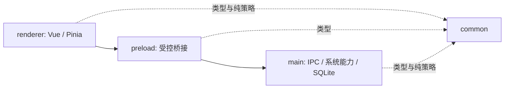
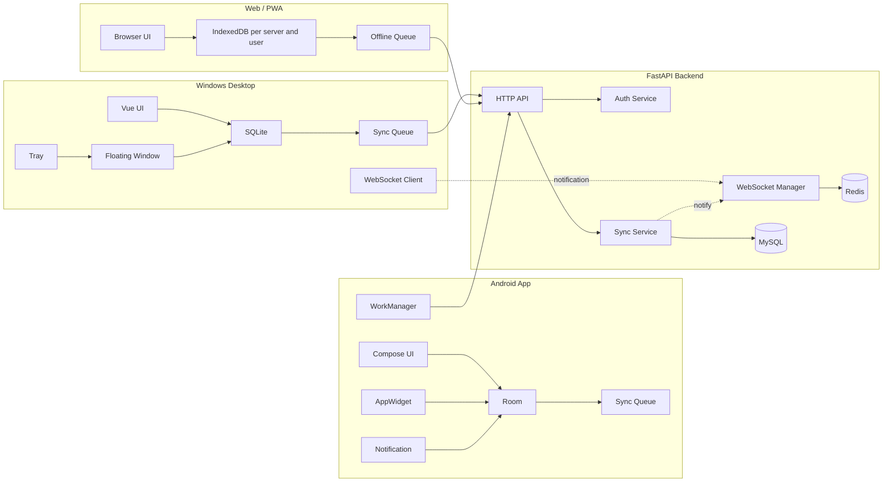

# 架构说明

TaskBridge 由后端服务、Web/PWA、Android App 和 Windows 桌面端组成。系统采用本地优先架构，客户端先写本地数据库，再通过同步队列与服务器保持一致。

## 仓库目录

各端保留独立构建入口，目录按运行环境和职责划分：

```text
TaskBridge/
├── android/              # Kotlin / Compose Android 应用
├── backend/              # FastAPI 服务、迁移与后端测试
├── desktop/              # Electron / Vue 桌面应用
│   ├── main/             # 主进程、SQLite、Token 和系统能力
│   ├── preload/          # 向沙箱界面暴露受控桥接
│   ├── renderer/         # Vue 界面、Pinia 和桥接调用
│   ├── common/           # 主进程与界面共用的类型和纯策略
│   ├── scripts/          # 桌面构建、原生依赖和专用检查
│   └── tests/            # 桌面行为测试与集成回归
├── web/                  # 独立原生 JavaScript PWA
├── shared/               # OpenAPI 契约和跨端测试向量
├── scripts/
│   ├── checks/           # 仓库治理与跨端检查
│   └── lib/              # 检查脚本共用工具
├── deploy/               # Compose 部署、备份与恢复
└── docs/                 # 使用、开发、架构与设计记录
```

`web/` 和桌面 renderer 是独立客户端。根 `shared/` 保存跨语言契约与测试数据；`desktop/common/` 仅服务桌面应用，不承诺跨端可复用。Web 和桌面的本地 ID、数据库及队列模型不同，不能直接共享持久化对象。

仓库级检查从根目录运行 `npm run check:<名称>`；桌面目录保留对应命令代理以兼容现有 CI。Electron 原生依赖、构建、打包仍在 `desktop/` 执行。

## 桌面进程边界



- `main/` 负责数据库、Token、窗口、托盘、通知、更新和 IPC 校验。
- `preload/` 只提供受控接口，不承载业务流程。
- `renderer/` 管理界面、状态和用户交互，通过桥接访问本地能力。
- `common/` 定义共享类型与不依赖 Vue、DOM、Electron 的策略，不反向导入 renderer 或主进程。

构建入口由 `electron.vite.config.ts` 管理，输出固定为 `out/main/index.js`、`out/preload/index.cjs` 和 `out/renderer/index.html`；目录调整不改变安装包的加载约定。

## 产品边界

- **后端服务：** 负责账号、设备、任务持久化、同步顺序、同步日志和 WebSocket 通知。
- **Android App：** 负责移动端任务管理、本地缓存、后台同步、系统提醒和桌面小组件；会话失效后保留工作区身份，但不再调度同步或连接 WebSocket。
- **Web/PWA：** 负责浏览器端任务查看、新建、编辑、搜索、完成、删除、恢复和后端同步状态查看；远程任务列表通过 `cursor_id` / `cursor_updated_at` 分页拉取，避免只展示第一页；通过按“规范化 API 地址 + 用户 ID”分库的 IndexedDB 保存任务快照和离线队列。同源页面浏览器重开时优先通过 HttpOnly Refresh Cookie 恢复在线会话；跨源请求不携带 Cookie，但当前页面仍使用 `sessionStorage` Token；Cookie 无法恢复时，只有当前服务器匹配且缓存已完成初始化，才可用最小身份摘要重新打开本机缓存，重新登录后才会上传队列。
- **Windows 桌面端：** 负责桌面端任务管理、本地缓存、托盘、悬浮窗、全局快捷键和常驻 WebSocket；刷新会话被拒绝时只删除 Token，保留当前数据库工作区供本机模式继续使用。

## 架构原则

1. 客户端本地优先，所有用户操作先写入本地数据库；Web/PWA 使用 IndexedDB 承载浏览器端缓存和 offline queue。
2. HTTP API 是唯一真实同步通道。
3. WebSocket 只发送通知，不承载完整任务数据。
4. 服务端是服务器侧权威数据源，任务归属必须按 `user_id` 校验。
5. 同步冲突通过任务 `version` 做乐观锁检测。
6. Android 后台同步交给 WorkManager，不长期保活 WebSocket。
7. Windows 桌面端可常驻 WebSocket，并在断线后自动重连。
8. 客户端渲染层不直接持有数据库、Token 和系统能力，敏感操作必须经过受控桥接层。
9. 任务时间线排序属于跨端契约，后端、Android、Windows 桌面端必须使用 `shared/task-timeline-fixtures.json` 的同一组样本验证完成态别名、逾期、计划日期、优先级、手动排序和完成时间倒序。
10. 在线状态和认证状态分开处理；恢复联网不等于恢复登录，任何客户端未持有会话 Token 时都不得调度 Worker、连接 WebSocket 或发送离线队列。
11. Web/PWA 的远端刷新必须对当前筛选范围执行缓存对账：删除服务器已不再返回的陈旧快照，同时保留待同步和冲突记录。
12. Android、Windows 和 Web 的本地数据库、同步队列与同步游标都以“规范化服务器 Origin + 用户 ID”作为工作区边界；切换任一项都必须切换工作区，不能复用上一服务器的数据。
13. 直接创建任务使用稳定 `client_request_id`，离线重放不能因响应丢失产生重复任务。
14. 重复任务后继由服务端按父任务 ID 幂等生成；客户端不为尚无 `server_id` 的任务自行创建后继。

## 跨端排序契约

任务列表默认按“逾期、即将到期、计划日期、稍后、无时间、已完成”排序；未来的 `snoozed_until` 会暂时取消逾期状态。完成状态读取时同时接受 `completed` 和历史别名 `done`，写入时统一写 canonical `completed`。`shared/task-timeline-fixtures.json` 是这套行为的共享测试向量：

- 后端通过 `backend/tests/test_task_timeline_fixtures.py` 验证 `/api/v1/tasks` 普通列表、cursor 分页、today 视图和 meta 计数。
- Android 通过 `TaskTimelineTest` 和 `TodayTaskWidgetRepositoryTest` 验证领域排序和小组件 raw projection 排序。
- Windows 桌面端通过 `npm run check:task-order` 验证 Vue 排序工具和 Electron SQLite 查询不会退回单值 `completed` 判断。

## 模块图



## 后端职责

后端维护用户、设备、任务、同步日志和在线设备状态。

主要目录：

| 目录 | 职责 |
| --- | --- |
| `app/api` | FastAPI 路由和鉴权依赖 |
| `app/core` | 配置、安全、数据库、Redis、统一响应和异常处理 |
| `app/models` | SQLAlchemy ORM 模型 |
| `app/schemas` | Pydantic 请求和响应模型 |
| `app/services` | 认证、任务、设备、同步和 WebSocket 业务流程 |
| `app/services/tasks` | 重复任务规则、后继生成与并发查重 |
| `app/services/sync_log_service.py` | 任务操作与同步流程共用的日志写入 |
| `app/repositories` | 复杂数据访问边界 |
| `tests` | 后端自动化测试 |

任务服务与同步服务共同依赖同步日志、重复任务模块，公共模块不反向导入协调服务。重复任务的父记录锁定、事务边界与幂等检查集中在一个实现中，避免 HTTP 创建和同步重放各自实现规则。

Android 的依赖方向为 `ui → domain`、`data → domain`，应用装配负责组合仓库与平台能力。Room 实体到领域对象的映射位于 `data/repository/Mappers.kt`，领域模型不引用 Room 实体。

新增代码应放入拥有该职责的模块。涉及多个客户端、发布或仓库策略的检查放在根 `scripts/checks/`；仅依赖 Electron 或桌面实现的工具留在 `desktop/scripts/`。

## 客户端职责

Android 和 Windows 都需要按服务器与用户工作区分别维护：

- 当前登录用户。
- 当前设备 ID。
- Access Token 和 Refresh Token。
- 最近一次成功拉取时间 `last_sync_time`。
- 等待上传的本地变更队列。
- 任务本地状态和同步状态。

Web/PWA 在当前浏览器会话的 `sessionStorage` 中维护页面使用的 Access Token 和 Refresh Token；同源请求同时通过限定认证路径的 HttpOnly Cookie 保存可轮换的 Refresh Token，使浏览器重开后可恢复在线会话。同源标签页通过 `BroadcastChannel` 接收同一次轮换的 Token 对，并用同一把 `Web Locks` 锁串行刷新；Token 广播只存在于页面内存，不写入持久存储。跨源请求使用 `credentials: omit`，避免通配 CORS 被浏览器拒绝，因此跨源页面关闭后需要重新登录。`localStorage` 仅保存 `{id, username, email, api_base_url}` 最小身份摘要和主动退出抑制标记，用于重新定位该服务器和账号对应的 IndexedDB；数据库以规范化 API 地址和用户 ID 共同隔离，并用 `cache_ready` 元数据标记可恢复状态。旧版仅按用户 ID 命名的数据库会在首次读取时迁移。Cookie 无法恢复且未重新登录时，本机修改只进入离线队列。

Android 和 Windows 使用同样的会话 / 工作区分离原则：刷新令牌被服务器拒绝时清除加密 Token，但保留“服务器 Origin + 用户 ID”工作区身份；本机读写继续落在原 Room / SQLite 数据库。主动退出或切换服务器才清除工作区身份。同步管理器、后台 Worker 和 WebSocket 在 Access Token 为空时必须短路。

## 数据流

1. 用户在客户端新增、编辑、完成或删除任务。
2. 客户端写入本地数据库。
3. 客户端将任务标记为 `pending_create`、`pending_update` 或 `pending_delete`。
4. 网络可用时，客户端调用 `POST /api/v1/sync/push`。
5. 后端校验用户、设备、任务归属和 `version`。
6. 后端写入任务数据和 `sync_logs`。
7. 后端通过 WebSocket 通知同账号下其他在线设备。
8. 其他设备收到通知后调用 `GET /api/v1/sync/pull`。
9. 客户端合并增量数据并更新本地界面、小组件或悬浮窗。

## 运维组件

- **MySQL：** 保存用户、设备、任务和同步日志。
- **Redis：** 用于在线设备状态、WebSocket 辅助、短期 Ticket 和限流扩展。
- **Alembic：** 管理数据库迁移。
- **Docker Compose：** 用于运行 Web/Nginx、后端、MySQL 和 Redis；Web 服务同源代理 API 与 WebSocket。
- **GitHub Actions：** 用于 CI、Release 和 GHCR 镜像发布。

## 安全边界

- 后端所有业务数据按 `user_id` 过滤，任务父子关系也必须校验归属。
- Refresh Token 绑定设备；删除设备会撤销该设备登录态。
- WebSocket 使用短期 Ticket，连接后仍校验 `device_id`。
- Android 和 Windows 的公开 Release 只上传通过签名验证的客户端；缺少签名配置时省略对应下载文件，本地仍可构建 unsigned 包做开发验证。
- Windows Electron renderer 启用 sandbox，IPC 会校验调用方窗口。
- Docker release 部署默认提供 Web 入口 `8080`；API 可限制为宿主机回环地址，MySQL 和 Redis 保持在 Compose 内部网络。
